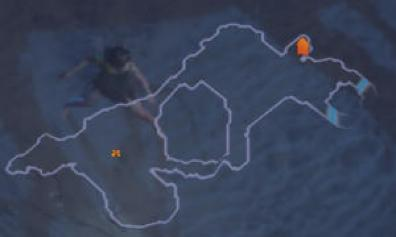

# 08 — Area transitions (exits between areas)

State of 2026-10-16: Lioneye's Watch has its exit to **The Coast** at the town's east edge. The client creates it,
shows its icon on the map and puts it in the wake zone. Using it is in [09](09-area-change.md).
2026-10-17: the exit sits on the gate and highlights the gate's arch on mouse-over like the real game (§5).



Code: `AreaTransitionObject` (`src/GameServer.Core/Protocol/Instance/InstanceEntities.cs`), `Program.Exits`
(`src/GameServer.Gateway/Program.cs`). Tests: `InstanceEntitiesTests.Area_transition_blob_layout_and_type`,
`Area_transition_with_a_tile_object_model_rotation_and_height`.

## 1. What an exit is

A server object of type **`Metadata/MiscellaneousObjects/AreaTransition`** (MurmurHash2 key, see
[04](04-player-entity.md#1-object-types-need-no-registration-message); the type is in the client's register, and live it
was created without "Unknown object type"). Its `.ot` file:

| Component | Notes |
|---|---|
| Positioned | `object_size = 6`, `blocking = false` |
| BaseEvents | `server_only = true` (no client data) |
| Animated | |
| AreaTransition | the destination |
| Stats | |
| ObjectMagicProperties | stat descriptions `map_stat_descriptions.txt` |
| MinimapIcon | `icon = 18` |
| InteractionAction | |
| client: Render, Targetable | `display_text = "ObjectDisplayTextAreaTransition"` (the label is the destination's name) |

Sent like the player: **0x2b9** (object id 0x2000 for the first exit) before 0x21, which queues it until the world
activates, then **0x1a9** (wake zone) after 0x21.

## 2. The component blob (traced with Frida, 41 bytes, consumed exactly)

The live object's components, in deserialize order: Positioned `0x1435a0f18`, BaseEvents `0x1435a55e8` (no data),
Animated `0x1435a5030`, AreaTransition `0x14346de00` (a client subclass, slot 17 `0x14166bb80` → base `0x141e5b870`),
Stats `0x1435dd4e8`, ObjectMagicProperties `0x1435a6ae0` (slot 17 → slot 20 `0x141e77990`), MinimapIcon
`0x1435a7018` (slot 20 `0x141e6f5d0`), InteractionAction `0x14359f7d0` (`0x141e1e240`), then two the loop does not reach
(`0x143468920`, `0x14346c238`).

| Part | Bytes | Fields |
|---|---|---|
| object flags, base data | `00 00` | as the player |
| Positioned | 16 | i32 x, i32 y (grid), f32 rotation, u16, 2 flag bytes; + 8 with the fixed height (§5) |
| Animated | `00` | flags; bit0 + u32-counted UTF-16 `.ao` path for a model (§5) |
| **AreaTransition** | 5 | u8 flags (low nibble = state `+0xb2`, bit4/5/6 → `+0xb5/+0xb6/+0xb7`, bit7 → extra record `0x141e62df0`); **destination variant** (`0x141e62490`): u8 index + value, index 0 → u16, 1 → u32, **2 → u16 WorldAreas.HASH16** (resolved by `0x141e5be60` through `0x1422d9920`, the same lookup as 0x14/0x1d); then a compact int `+0xa4`, read when the type's flag (`type+0x78 → +0xb0 → +0x14`) is set and the state is 0 (true for this type) |
| Stats | 10 | as the player's comp1: compact-int n pairs, u32, u32, u8 |
| ObjectMagicProperties | 4 | **base magic properties first** (`0x142201d70`, called with the reader still in `rdx`: u16 flags, rarity = low 3 bits, u8 `+0x7a`, sections behind flag bits 0x10/0x40/0x200/0x400/0x800 and, with bit3, 0x80/0x100/0x20), then the component's own u8 flags (bit1 → u16 flavour text key, bit2 → string) |
| MinimapIcon | `00` | u8 flags (bit1 hidden/shown, bit0 → u16 icon override, bit3 → variant) |
| InteractionAction | `00` | u8 flags (bit2 → u8 [+ u16 action]) |
| tasks | `00` | |

The Coast exit: `00 00 | 80010000 D9000000 00000000 0000 0000 | 00 | 00 02 D27A 00 | 00 00000000 00000000 00 | 0000 00 00 | 00 | 00 | 00`.

How the deserializers were found: name string (`strexact.py`) → static initializer (`0x14006xxxx`: AreaTransition
`0x140067c60`, MinimapIcon `0x140068870`, InteractionAction `0x1400667c0`, ObjectMagicProperties `0x140068d00`,
BaseEvents `0x140067cd0`) → pool (`0x1445bb800`, `0x1445bc1b0`, `0x1445ba6c0`, `0x1445bbea0`, `0x1445bb7b0`) → factory
(`0x141e5b1d0`, `0x141e6e5e0`, `0x141e1c9e0`, `0x141e775c0`, `0x141e5e220`) → vtable → slot 17 (+0x88). Then three Frida
rounds fixed the byte counts: AreaTransition needed the compact int, and ObjectMagicProperties needed the 3-byte base
part that the decompiler hid (a call that reuses `rdx`).

## 3. Where exits go: the area's layout files

The server has to place each exit where the client's own layout expects it. For Lioneye's Watch:

1. `WorldAreas` row `1_1_town` (HASH16 `0x235c`): `Connections` = `1_1_1` The Twilight Strand, `1_1_2` **The Coast**
   (HASH16 `0x7ad2`); `TopologiesKeys` → `Topologies` row `ShoreEncampTownNormal` → DGR file
   `Metadata/Terrain/Act1/Town/Graphs/beachtown.dgr`.
2. The DGR has a single node: `19 11 0 "beachtown" R270 3 "default" "entrance2" "entrance1disabled" …`, i.e. room
   "beachtown", rotated 270°, with three named points enabled or disabled.
3. `Metadata/Terrain/Act1/Town/master.tsi` → `generate.rs` → room `Rooms/beach_town_unique_normal.arm` (version 36,
   18 × 30 tiles of 23 cells = 414 × 690). Its named points, in room cells:
   ```
   105 123 3.14162 "entrance1"
   196 384 0.261828 "entrance2"
   178 346 12.5664 "default"
   ```
4. The R270 placement maps room (x, y) to the 690 × 414 area grid as **(y, 413 − x)**. That is the only rotation that
   puts all three points on walkable cells of the client's walkability dump:

| Point | Room | Grid | Role |
|---|---|---|---|
| entrance1 | (105, 123) | (123, 308) | disabled in the DGR: the one-way Twilight Strand side |
| **entrance2** | (196, 384) | **(384, 217)** | **exit to The Coast**, east edge (matches the map icon) |
| default | (178, 346) | (346, 235) | the default arrival point (where a player coming into town appears) |

`scripts/re/worldareas.py` reads WorldAreas rows (Id, Name, Act, IsTown, HasWaypoint, Connections, AreaLevel,
HASH16) straight from `Data/WorldAreas.datc64`. The JSON extraction of that table is still broken past the early columns.

## 4. All zones: what it takes

- **Fixed layouts (towns, hideouts, many boss arenas):** the method above works per area: WorldAreas →
  Topologies → DGR → room `.arm` named points → rotation, then which point leads where. Named entrance points line up
  with `Connections` by name and DGR tags (enabled or "…disabled"). Matching names to destinations still needs care for
  areas with several exits. Doing this for every town and fixed area is mechanical work.
- **Generated areas (most outdoor and dungeon zones):** the layout comes from the area seed through the client's level
  generator (the DGR is a graph of rooms joined by randomly picked tiles). The exits sit on the generated layout, so the
  server must either reproduce the generator or learn the positions from the client (for example a Frida dump after
  generation, as was done for walkability). This is the large part.
- **Using an exit (captured live):** clicking the exit sends **C→S 0x24** "use skill on object", 12 bytes:
  `0024 00002000 0266 1066 0408` = u16 id, **u32 target object id (0x2000, the exit)**, u16 skill id `0x0266` (the
  interaction skill), u16 sequence (`0x1066`, `0x1067`, … like 0x25), u16 flags `0x0408`. It is 0x25's sibling aimed at
  an object instead of a cell. A `0016 08 0000` (C→S 0x16, 5 bytes) was also seen. The client keeps re-sending 0x24 while
  nothing answers. Next: echo the action (as 0x1ab does for 0x25) and then move the player to the destination area,
  most likely with a new 0x14-style instance assignment or an area change on the same connection.

## 5. Tile objects: the exit's model, rotation and height

The white arch the real game highlights on mouse-over is not a separate model file. It belongs to the town **tile**.
`Metadata/Terrain/Beach/Town_v2/beachencampment_v01_01.tdt` names the tile
`Art/Models/Terrain/Beach/BeachTown_v2/beachencampment_v01_01.tgt`, and next to it
`beachencampment_v01_01.tmd` lists the tile's placed objects.

**`.tmd` (version 5):** u8 version, u8 count, then count × 36-byte records, then a u32 length in UTF-16 units and the
string table. Record: f32 x, f32 y, f32 z (tile-local world units; 250/23 per cell, z negative = up), u32 `0x80000000`,
u32 0 (the same in every record here), then four u32 string offsets (in UTF-16 units from table start + 2): name,
mesh `.fmt`, object type, `.ao` (`0xffffffff` = none). The town tile has 17: torches (`Doodad` + `TorchFire.ao`), the
waypoint, `transition_twilightstrand` (`AreaTransitionMapMarker`) and:

| Record | Mesh | Type | Tile cell | z |
|---|---|---|---|---|
| `beachencampment_v01_01_area_transition2` | `…_area_transition2.fmt` (material `transparentobjectsc.mat`) | `AreaTransition` | (113.5, 319.5) | −351.04 |

The `.fmt` is a flat vertical plane (every vertex at local x = −2.24, y −108…+116, z 0…−234): the pivot is the bottom
centre of the arch, and it is only visible when highlighted.

**How the server gives the exit that mesh** (found by scanning the live client's memory for the record name): for
each record the client registers a **virtual `.ao`** named `<.tdt folder>/<record name>.ao`, here
`Metadata/Terrain/Beach/Town_v2/beachencampment_v01_01_area_transition2.ao`. It is not in the bundle index. The server
sends that path in the exit's Animated component. Animated accepts only `.ao` (the `.fmt` path itself throws "Filename
must end with .ao", `0x141da7d80`); its bit1 form is a `Data/MiscAnimated.dat` row, not used here.

**Placement**, all from the files:
- position: tile cell (113.5, 319.5) + the tile's slot in the room (`k 15 18 …` at tile column 3, row 3 of
  `beach_town_unique_normal.arm` = +69 cells) = room (182.5, 388.5), then the R270 mapping of §3 = **grid (388, 230)**
  (world = (grid + 0.5) × 250/23, i.e. the record's exact position). Checked: the same mapping puts the waypoint record
  at (256.5, 168.5); live the player reads (256, 170) there.
- rotation: Positioned's float `+0x29c`. The plane must face across the gate, so 90° or 270° (the room's R270); live,
  **π/2** matches the real game. The sign convention is not derived yet.
- **height:** Positioned flags0 bit2 (`0x04`) adds i32 `+0x290` (steps of 7.8125) and f32 `+0x2b4` (world z); when
  `+0x290` ≠ `0x7fffffff` the client uses that z instead of the terrain height (`0x141e331e0`, `0x141e35800`). Sent as
  −45 and **−351.04**. Without it the arch's base sat on the terrain and the beam hid its top.

The server's blob: Positioned `84010000 E6000000 DB0FC93F 0000 04 00 D3FFFFFF 1F85AFC3`, Animated `01 49000000` + the
path. Dev commands in the Gateway: `/exit_pos`, `/exit_rot <degrees>`, `/exit_z <z | none>`, `/exit_model <path |
none>`, `/exit_index <n>` (the AreaTransition compact int; the client reads it as a teleport/door destination, not a
mesh link).

Other exits: an exit that is a `.tmd` record takes its model, rotation and height this way. The Twilight Strand gate is
`transition_twilightstrand` (type `AreaTransitionMapMarker`) at tile cell (37.5, 45.5), grid (114.5, 306.5).

## Open

- The rotation's sign convention (π/2 was picked live from 90°/270°); check it on a tile object whose mesh is not
  symmetric before placing other tile exits.
- Arrival points: when coming back from The Coast, the player should appear at entrance2. A fresh login should
  probably use "default" (346, 235) instead of today's (197, 261).
