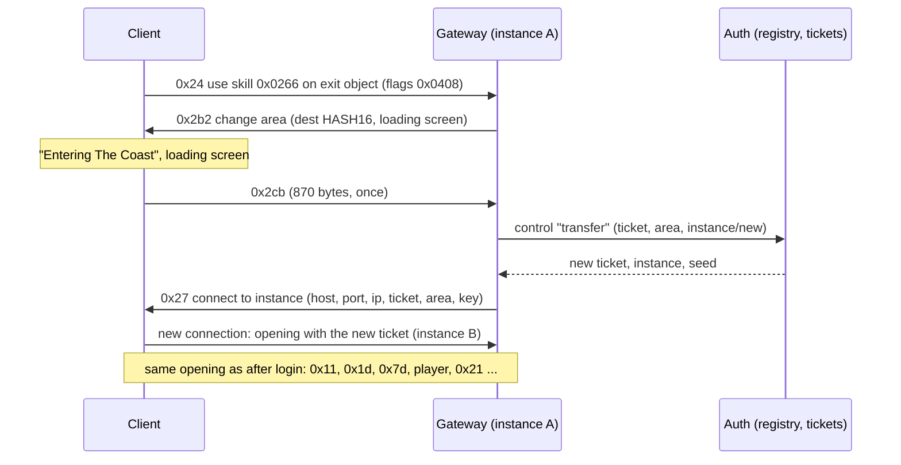

# 09 — Changing area: exits, instance details (0x27) and the instance chooser

Status (live, 2026-10-16): clicking The Coast in Lioneye's Watch shows the loading screen and loads The Coast. Ctrl+click
opens the Instance Manager. Its rows list the live instances, "New" creates one, and "Enter" joins an existing one. The
exit objects themselves are in [08-area-transitions.md](08-area-transitions.md).

## 1. Flow

With Ctrl held, 0x24's flags are 0x040c. The server then answers 0xae (instance list). The client opens the chooser and
answers 0xaf with the row it picked. After that the flow is the same as a plain click, from 0x2b2 on.

## 2. Why 0x27 and not login 0x14

The first attempt pushed login 0x14 from Auth after 0x2cb. The client dispatched it (`0x14213f190`, case 0x14), but the
listener list at login+0x298 is **empty** in game (checked with Frida). Nothing in game listens to the login connection
for instance details. Login 0x14 is only handled at character select (`0x140d0df10` → `0x140d59b70`).

In game, the "instance details" path is:

- The in-game state is constructed by `0x140d55be0`. Its primary vtable is `0x1431ec558`, and slot 38 (+0x130) is
  `0x140d59b70`, which logs "Got Instance Details from login server" and opens the new instance connection
  (`0x1415a4fe0`).
- `0x140d5bf60` wires the state's listeners onto the **instance** client. One of them, at instance+0xa00 (the
  dispatcher sees it as +0x9f0), is the forwarder `0x140d63d24` (`mov rax,[rcx]; jmp [rax+0x130]`).
- Instance dispatcher `0x14214a190`, case 0xe (= id 0x27, `dispatch_ids.py`), builds the same details object as login
  0x14 (`0x142173680` → `0x14213be50`) and notifies that list (`0x142171ee0(this+0x9f0, …)`).

So the old instance server tells the client where to go next.

## 3. Messages

### C→S 0x24 — use skill on object (12 bytes)

`u32 target object id, u16 skill (0x0266 = interact), u16 sequence, u16 flags`. Flags are 0x0408, or 0x040c with Ctrl
(bit 0x0004). The client repeats it while nothing happens, so the Gateway ignores repeats while a transfer is pending.

### S→C 0x2b2 — change area

Class `0x1435bfee0`, write `0x141f92980`, dispatcher case 0xe8. Fields: `u16 destination WorldAreas.HASH16, u16
LoadingScreenOverrides row` (0 = the area's default). The handler shows the loading screen and calls `0x142148690`. That
function sends 0x2cb once (flag +0xcd4a) and flushes. An unknown hash is fatal.

### C→S 0x2cb — leaving (870 bytes)

Sent once after 0x2b2. Our framer does not know its layout yet, so it arrives "unframed". The Gateway takes the id as
the signal to transfer. If no 0x2cb arrives, the Gateway transfers anyway after 2 s.

### S→C 0x27 — connect to instance

Class vtable `0x1435dc280` (ctor `0x14219dd90`, write `0x14219ddf0`, read `0x14219df90`), dispatcher case 0xe.

| Wire order | Type | Field | Use |
|---|---|---|---|
| 1 | str (u16 len + bytes) | +0x10 | host (`127.0.0.1`) |
| 2 | u16 | +0x86 | port (6112) |
| 3 | u32 | +0x30 | IPv4, big-endian (0x7f000001) |
| 4 | u32 | +0x34 | not passed on by the handler; 0 |
| 5 | u16 | +0x84 | area HASH16 (must exist: "Server sent area hash for area that doesn't exist") |
| 6 | u32 | +0x38 | ticket |
| 7 | u8 | +0x88 | unknown; 0 |
| 8 | u8 | +0x89 | passed on like login 0x14's last u8; 0 |
| 9 | 64 bytes | +0x3c | instance key (HMAC-SHA512(secret, ticket), as for login 0x14) |
| 10 | 8 bytes | +0x7c | unknown; zeros |

The client keeps the old connection until the new one is up, then the Gateway sees it disconnect.

### S→C 0xae — instance list

Class `0x1435dca40`, write `0x1421a2300`, dispatcher case 0x2e → listeners at +0x6cf0. This opens the
InstanceChooserWindow ("Instance Manager"). Layout: `u16 area HASH16, u8 (+0x14), u8 n`, then n entries. Each entry is
`raw u64 LE, u32 BE, u8, u8 m + m × wstr`.

What the window shows (live):

| Field | Column |
|---|---|
| u64 | "Created": Unix seconds, shown in local time. Sending the instance id 2 showed "01 January 1970, 03:00:02". |
| u32 | "Time Left": seconds |
| names | "Players"; an empty list shows "None" |
| u8 | unknown (probably "Realm", which shows "-") |

The "New" row is always there. Its text ("Non-hideout instances stay open for 8-15 minutes") comes from the client.

### C→S 0xaf — chooser pick (3 bytes)

`u8 row`: 0xff = "New", otherwise the index of the row in the last 0xae. The client sends no instance id, so the Gateway
keeps the ids of the last list it sent (`ChooserList`).

## 4. Server side

- **InstanceRegistry** (`src/GameServer.Core/World/InstanceRegistry.cs`):
  - A town has one instance.
  - A plain click joins the character's previous live instance of the area, or creates one.
  - The chooser can join any instance or create a new one.
  - An instance with no players is kept for 6 minutes (`Lifetime`). `TimeLeft` is the full lifetime while someone is in
    it.
- **Auth** owns the registry and issues tickets (`InstanceDirectory`, control port 127.0.0.1:20495). Control ops:
  `resolve`, `list`, `transfer` (returns the new `Ticket`), `leave`.
- **Gateway**:
  - Ctrl+click → `list` → 0xae.
  - 0xaf or a plain click → 0x2b2.
  - 0x2cb → `transfer` → 0x27 with the key for the new ticket.
  - On the new connection, `resolve` gives the area and seed. Layout: `data/walkability/<id>_seed<seed>.bin` + `.json`.
    The spawn is the deepest walkable cell until arrival points are known.
- The dev servers pin non-town seeds to 1 (`Game_RANDOM_SEEDS=1` gives random seeds), because a layout must be dumped
  from the client (`scripts/re/frida/dump-walkability-all.js`, `walk-<n>-a.bin`). The Coast at seed 1 is 1725×1725.

## 5. Open

- Arrival point: where the player appears next to the exit they came through. The Coast currently uses the deepest cell.
- The Coast's own exits (back to town, to The Mud Flats) and the exits of other areas.
- C→S 0x153 (2 bytes, Esc → "Exit to character selection") gets no answer yet, so the client waits.
- 0x2cb's layout, 0x27's u32 +0x34 and u8 +0x88, 0xae's u8 fields.
