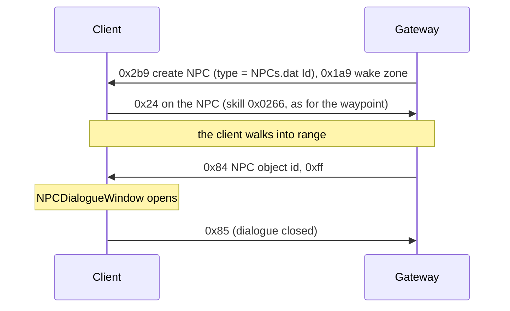

# 17. NPCs

State of 2026-10-19: Tarkleigh, Nessa and Bestel stand in Lioneye's Watch. They show their name on hover and on the minimap, and
clicking one walks the player to them and opens the NPC dialogue window. Verified live with the real client. The
window's options come from the client itself (NPCTalk); choosing one is not handled yet.

## 1. The NPC object

An NPCs.dat row's `Id` (`Metadata/NPC/Act1/Tarkleigh`) is an .ot type, created with S→C 0x2b9 like any object
(type = `ObjectTypeHash(Id)`). `Metadata/NPC/NPC.ot`: Positioned (`object_size = 5`, blocking), Animated, BaseEvents
(`server_only`), InteractionAction, NPC, MinimapIcon (`icon = 3`), client Render (`ObjectDisplayTextNPC`) + Targetable.
The child .ot only sets its `animated_object`.

Of the NPC types in `data/object-types.json`, 190 have exactly that list; 54 add Transitionable, 31 StateMachine, and a
few ControlZone, Functions, Stats or Brackets (not written yet).

| Part | Bytes |
|---|---|
| Positioned | as a monster's ([10](10-chat-and-commands.md) §5): x, y, f32 rotation, u16 team 0, flags `00 02 00 01` |
| Animated | `00` (the type supplies the model) |
| BaseEvents | nothing |
| InteractionAction | `00` |
| NPC | two u8 (slot 17 `0x141e75050`): `+0x20` has dialogue (`0x141e76d40` lists NPCTalk rows only when set), `+0x21` index of a component that must be alive, `0xff` none. Sent `01 ff` |
| MinimapIcon | `00` |
| Transitionable, StateMachine | as for monsters |

The NPC component's debug dump (`0x141e751d0`) prints the NPC and the NPCTalk row the client picks for the player
(`0x141e76d40`): the client chooses the dialogue itself.

## 2. Where town NPCs stand

The client files do not place them. Lioneye's Watch is one room, `beach_town_unique_normal.arm`, whose only named points
are `entrance1`, `entrance2` and `default`. The town tiles' `.tmd` objects are the waypoint, the area transition and
doodads, and `Tarkleigh.ot` has only its model. The real server has its own data, so `NpcCatalog.Towns` holds cells
measured on the real game's minimap: the minimap projection was fitted on our NPCs' known cells and the waypoint (under one cell of error), then inverted for the real markers. Facing is not set yet (`/npc_face <name> <degrees>` turns one live):

| NPC | Cell |
|---|---|
| Tarkleigh | (388, 182) |
| Nessa | (346, 271) |
| Bestel | (361, 246) |

## 3. Messages

### C→S 0x24: talk

A click on an NPC sends 0x24 (use skill on object, [09](09-area-change.md)) with skill `0x0266`, the same interaction
as the waypoint. The client walks to the NPC first. The Gateway follows the walk (`NpcReach` 8 cells, not measured)
and then answers with 0x84.

### S→C 0x84: open the dialogue (13 bytes)

World group, class `0x1435dd7d8`, read `0x141fddcb0`: the object header (u16 id, u32 BE object id → `+0x10`, u32, u16),
then u8 → `+0x20`. The world handler `0x142187480` calls `0x142149db0(instance, object id, u8)`:

- object id 0: closes the dialogue (clears instance `+0xd7c0`).
- u8 `0xff`: sets instance `+0xd7c4`/`+0xd7c8` to the NPC and fires the listeners at instance `+0x13f8` →
  `0x140dcc720` (in-game UI, registered by `0x140dbcd40`) → `0x14071f6d0` → `0x140723d60` (NPCDialogueWindow setup).
- other values: another path that looks at the NPC component's data (`+0x66`), not mapped.

### C→S 0x85: dialogue closed (2 bytes)

Id only. Live 2026-10-19 it came after every opened dialogue, when the window closed (Goodbye, Esc or walking away).

### C→S 0x82: option (3 bytes)

u8 = the chosen NPCTalk row's index among the NPC's rows (column 1). The client (`0x140722960`) handles NPCTalkCategory 5
(Topic), 0x19 and 0x26 itself and sends 0x82 for the others. The Gateway answers by category:

| Category | Answer |
|---|---|
| Gossip, Quests, QuestReward | S→C 0x84 with the index: the window plays the row's text and audio (verified) |
| BuyItems | shop tab (S→C 0xc0, manager 1) + S→C 0x8c (verified: the buy window shows the stock) |
| SellItems | two offer inventories (0xc0, manager 1) + S→C 0xb8 (window opens; drops and Accept not verified) |

C→S 0x85 during a talk = Continue → 0x84 0xff (back to the options); otherwise the Gateway answers 0x84 with object 0,
which ends the dialogue (without an answer the client stays in its dialogue state and the player cannot move).

## 5. Shops

- **S→C 0x8c** (read `0x1421a1f60`): u32 BE NPC, u16 BE (NPCShop row), u8, u16 n + n × u32 BE inventory ids (one tab
  each, looked up in inventory manager 1, instance +0xca10, `0x14216aa30`), u16 m + m × (compact uint, wstr name, u8)
  tab names. Listener `0x140dcccf0` → VendorBuy (UI +0x7b8, vtable `0x1431356b8`, +0x380 = `0x14073d570`).
- **C→S 0x88** (write `0x141f95380`): u32 BE shop item, u32 BE destination inventory (masked like 0x28's), u8 x, u8 y,
  u8, u8 flags, compact uint. The Gateway moves the item (0xbf on the tab, manager 1, and on the inventory) and takes the
  price from the main inventory's stacks.
- **Prices**: item Base flag bit 7: u8 n + n × (u32 item type hash, compact uint amount), stored in the Base's +0xb8 list.
  Ours: 1 Scroll of Wisdom for everything (`NpcShops`); whether the tooltip shows it is not checked.
- **Stock** is the server's (NPCShop only names shops): `NpcShops.Stock`.
- **Sell**: S→C 0xb8 (write `0x141d6acc0`): u32 BE other party (0 = NPC sale → VendorSell, UI +0x7c8), u32 BE your offer,
  u32 BE their offer (both manager-1 inventories, grids `0x140317440` / `0x140c605f0`), u8 flags, wstr name, u32 BE
  NPCs row, u16, u32 BE TradeWindowVisuals row, u16 (+0x54, shown as an error text when set), u16. The offer grids
  must use an Inventories.dat row that accepts items (row 83 refused every drop; row 0 now). C→S 0xb1 (u32, u8): Cancel
  sent u8 0; Accept assumed u8 1. S→C 0xb9 (u32, u8 accepted) closes the window. The NPC offers 1 Scroll Fragment per item.
- **C→S 0xb2** (16 bytes, write `0x141f95b40`): an item dropped into "Your Offer": u32 BE source inventory (13 = cursor),
  u32 BE item id, u16, u8 x, u8 y, u16 (changes per request). **C→S 0xb3** (12 bytes): u32 BE item id, u32, u16: the
  item taken back out. 0xb8 flags bit 4 (0x10) drops the "Mouse over each item to enable accept" rule
  (`0x140c37140`). Live 2026-10-19: drops into the offer work; Cancel closes the window but the player cannot move
  until another panel opens (P); Accept does not work yet.
- S→C 0x87 opens the quest reward window (u16 = QuestRewardOffers row, `0x140c2b690`); a wrong row crashes the client.

## 6. Dev commands

`/npc <NPCs row, Id or name> [rotation°]` creates an NPC next to the player, `/npcs` lists this connection's NPCs, and
`/pos` prints the player's cell (the server's estimate) for picking places.

## Open

- Selling: verify drops into the offer, Accept's message, real sell prices; quest rewards (0x87); Identify Items and
  Bestel's Respecialisation (no answer yet); real buy prices.
- The NPC component's two bytes, and 0x84's other mode values.
- The NPCs' facing (rotation 0 for now), and NPCs in the other towns and outside towns.
