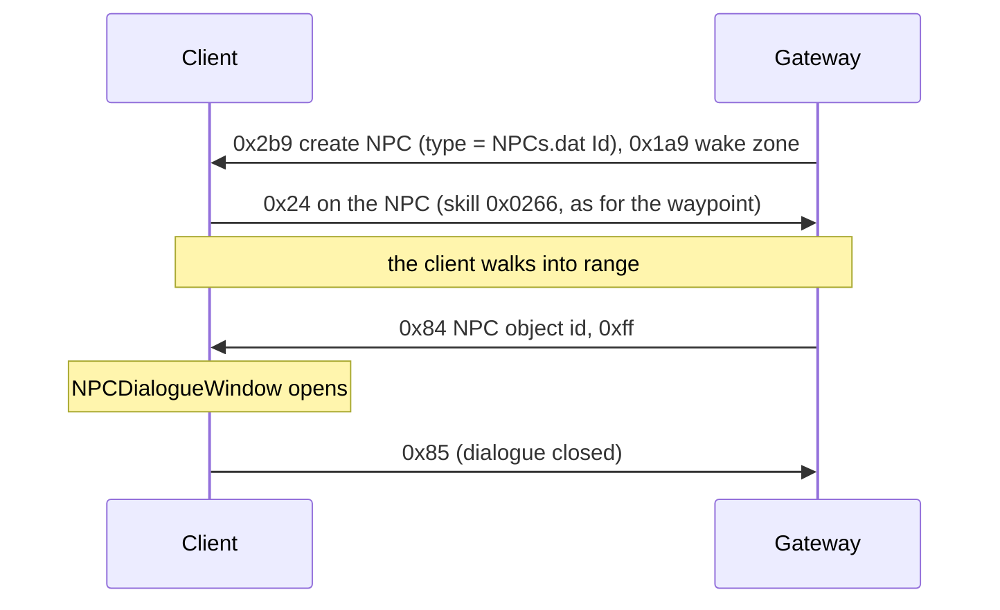

# 17. NPCs

State of 2026-10-19: Tarkleigh, Nessa and Bestel stand in Lioneye's Watch. They show their name on hover and on the minimap, and
clicking one walks the player to them and opens the NPC dialogue window. Verified live with the real client. The
window's options come from the client itself (NPCTalk); choosing one is not handled yet.

## 1. The NPC object

An NPCs.dat row's `Id` (`Metadata/NPC/Act1/Tarkleigh`) is an .ot type, created with S→C 0x2b9 like any object
(type = `ObjectTypeHash(Id)`). `Metadata/NPC/NPC.ot`: Positioned (`object_size = 5`, blocking), Animated, BaseEvents
(`server_only`), InteractionAction, NPC, MinimapIcon (`icon = 3`), client Render (`ObjectDisplayTextNPC`) + Targetable.
The child .ot only sets its `animated_object`.

Of the NPC types in `data/object-types.json`, 190 have exactly that list; 54 add Transitionable, 31 StateMachine, and a
few ControlZone, Functions, Stats or Brackets (not written yet).

| Part | Bytes |
|---|---|
| Positioned | as a monster's ([10](10-chat-and-commands.md) §5): x, y, f32 rotation, u16 team 0, flags `00 02 00 01` |
| Animated | `00` (the type supplies the model) |
| BaseEvents | nothing |
| InteractionAction | `00` |
| NPC | two u8 → `+0x20`, `+0x21` (slot 17 `0x141e75050`); `00 00` works, meaning unknown |
| MinimapIcon | `00` |
| Transitionable, StateMachine | as for monsters |

The NPC component's debug dump (`0x141e751d0`) prints the NPC and the NPCTalk row the client picks for the player
(`0x141e76d40`): the client chooses the dialogue itself.

## 2. Where town NPCs stand

The client files do not place them. Lioneye's Watch is one room, `beach_town_unique_normal.arm`, whose only named points
are `entrance1`, `entrance2` and `default`. The town tiles' `.tmd` objects are the waypoint, the area transition and
doodads, and `Tarkleigh.ot` has only its model. The real server has its own data, so `NpcCatalog.Towns` holds cells
picked live with `/pos` where the NPCs stand in the real game:

| NPC | Cell |
|---|---|
| Tarkleigh | (385, 188) |
| Nessa | (355, 263) |
| Bestel | (362, 249) |

## 3. Messages

### C→S 0x24: talk

A click on an NPC sends 0x24 (use skill on object, [09](09-area-change.md)) with skill `0x0266`, the same interaction
as the waypoint. The client walks to the NPC first. The Gateway follows the walk (`NpcReach` 8 cells, not measured)
and then answers with 0x84.

### S→C 0x84: open the dialogue (13 bytes)

World group, class `0x1435dd7d8`, read `0x141fddcb0`: the object header (u16 id, u32 BE object id → `+0x10`, u32, u16),
then u8 → `+0x20`. The world handler `0x142187480` calls `0x142149db0(instance, object id, u8)`:

- object id 0: closes the dialogue (clears instance `+0xd7c0`).
- u8 `0xff`: sets instance `+0xd7c4`/`+0xd7c8` to the NPC and fires the listeners at instance `+0x13f8` →
  `0x140dcc720` (in-game UI, registered by `0x140dbcd40`) → `0x14071f6d0` → `0x140723d60` (NPCDialogueWindow setup).
- other values: another path that looks at the NPC component's data (`+0x66`), not mapped.

### C→S 0x85: dialogue closed (2 bytes)

Id only. Live 2026-10-19 it came after every opened dialogue, when the window closed (Goodbye, Esc or walking away).

## 4. Dev commands

`/npc <NPCs row, Id or name> [rotation°]` creates an NPC next to the player, `/npcs` lists this connection's NPCs, and
`/pos` prints the player's cell (the server's estimate) for picking places.

## Open

- Choosing a dialogue option: what the client sends, and what the server answers (talk text, quest steps, rewards).
- Shops: Nessa's and Tarkleigh's ShopSets (buy and sell windows).
- The NPC component's two bytes, and 0x84's other mode values.
- The NPCs' facing (rotation 0 for now), and NPCs in the other towns and outside towns.
