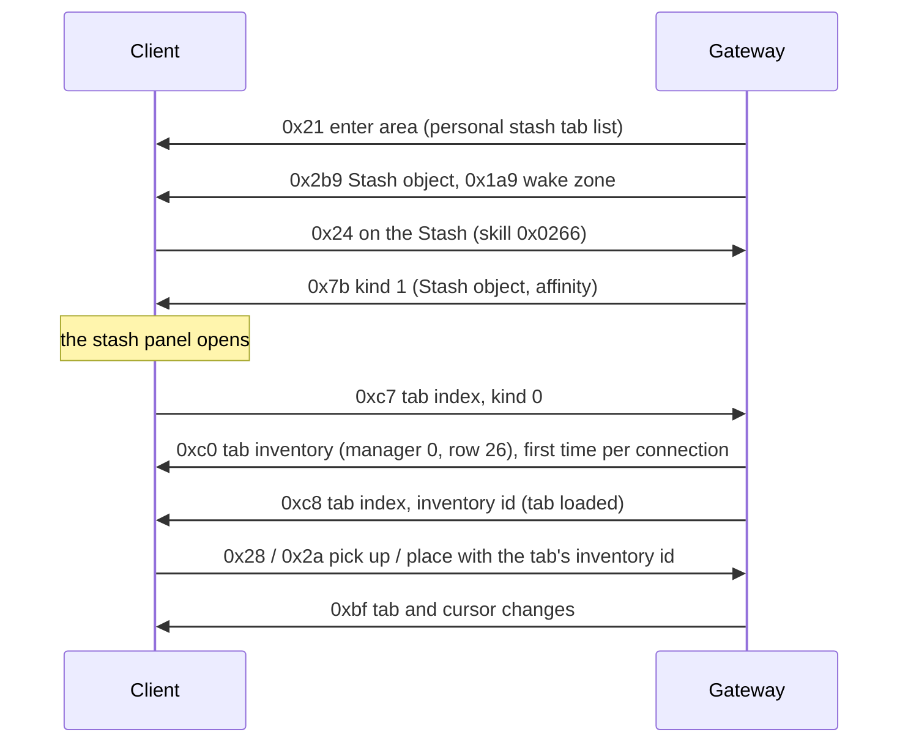

# 18. Stash

State of 2026-10-19: a Stash stands in Lioneye's Watch. Clicking it opens the stash panel with the account's tabs (11
starter tabs of several StashType kinds). The client asks for each tab's contents when it shows the tab, and items can
be put into and taken out of tabs. Tabs and items belong to the account: every character of the account sees the
same stash. Verified live (2026-10-19): the panel opens, all 11 tabs load, items go in and out of a normal tab by
click and by Ctrl + click, and the stash reopens on the last tab after a relog.

## 1. The Stash object

`Metadata/MiscellaneousObjects/Stash.ot`: Positioned (`object_size = 3`, blocking), BaseEvents (`server_only`),
Animated (`chest_v01_01.ao`), MinimapIcon (`icon = "StashPlayer"`), InteractionAction; client Render
(`ObjectDisplayTextStash`), Targetable, StateMachine (`open`). The blob is an NPC's without the NPC component:
Positioned as an NPC's (`… 00 02 00 01`), Animated `00`, MinimapIcon `00`, InteractionAction `00`, tasks `00`
(`StashObject`). It is not in the town tiles' `.tmd` records, so the server places it: `StashCatalog` (Lioneye's
Watch at (319, 272), next to Nessa). A click sends C→S 0x24 with skill `0x0266`, as for NPCs and the waypoint.

## 2. The tab list

The instance keeps three lists of 0x68-byte tab records (`0x14216cf60`): personal stash `+0xc498`, guild stash
`+0xc4b0`, trade tabs `+0xc4c8`. The panel (`0x140a87830`) builds one tab button per record.

- **S→C 0x21** (enter area, dispatcher case 10): its first two vectors are the personal stash list (→ `+0xc498`) and the
  trade tab list (→ `+0xc4c8`). The Gateway sends the account's tabs in the first.
- **S→C 0x136** (class `0x1435dc7a0`, read `0x1421a3350`, case 0x57): u8 kind (0 personal, 1 guild, 2 trade), u8 (which
  listener: `+0x8478` when set, else `+0x83f8`), then one list. Written (`InstanceStash.TabList`), not sent yet.

A list (`0x1421ba150`) is a u16 BE count and the records. A record (`0x141d4d1f0`):

| Wire | Field | Meaning |
|---|---|---|
| u32 BE | +0x28 | the tab's inventory id in the player's inventory manager (`+0xc890`) |
| u32 BE | +0x2c | copied to the panel tab's +0x30; 0 |
| wstr | +0x08 | name |
| str (u16 BE + bytes, `0x1408402a0`) | +0x48 | id string |
| u16 BE | +0x38 | button position; the panel sends C→S 0xcc when it differs from the order it builds |
| 2 bytes | +0x3d, +0x3e | flags, below; +0x3e bit 1 = contents loaded (set by S→C 0xc8) |
| u16 BE | +0x3a | parent folder's index, 0xffff none |
| u8 × 3 | +0x30..+0x32 | colour R, G, B |
| u8 | +0x34 | StashType row: 0 NormalStash, 1 PremiumStash, 3 CurrencyStash, 4 UniqueStash, 5 MapStash, 7 QuadStash, 8 EssenceStash, 9 FragmentStash, 16 Folder, 17 FlaskStash, 18 GemStash … |
| u64 | +0x00 | only with flag 0x20 |
| u8 | +0x3c | only with flag 0x10 |
| 4 bytes (raw) | +0x3f | only with flag 0x40: bitset of StashTabAffinityId rows |

+0x3d flags: 0x01 → panel tab bit 3; 0x02 premium (the tab settings `0x14025b420` can rename and recolour it); 0x08 →
panel tab bit 6; 0x20 the tab is left out of the panel; 0x40 the affinity bitset follows (the client keeps 0x40 set
while any bit is). Types 0x10 (Folder) and 0x19 get no contents request.

## 3. Opening the panel

**S→C 0x7b kind 1** (`0x142163420` case 1 → listeners at instance `+0x1178` → `0x140dcd5e0`): u32 a = the Stash
object (passed to `0x141661860`), u32 b = an affinity, clamped to 0x16. The handler opens the panel; when b ≠ 0x16 it
selects the first tab whose affinity bitset has bit b (with b = 3, a CurrencyStash tab scores higher), through
`0x140a83950`. Kind 2 (`+0x12f8` → `0x140dcd780`) is the same for the guild stash (`+0xc4b0`).

The client does not tell the server when the player switches tabs, and a second 0x7b while the panel is open closes
it (`0x140dc4db0` toggles), so the tab is chosen at the moment the panel opens. To open on the account's last tab the
Gateway sets affinity bit 0 (`UNUSED0`, no item has it) on that tab only and sends b = 0, on the first open of each
connection. Later opens send b = 0x16: the panel keeps its own tab while the connection lasts (verified live).

## 4. Tab contents

- **C→S 0xc7** (5 bytes, vtable `0x1435bff20`, write `0x141f95fa0`): u16 BE tab index, u8 kind. `0x142167010` queues
  it when a tab without a built page is selected (`0x140a85c30`) and when the panel opens on its current tab
  (`0x140a8d1b0`); the tick `0x142148880` sends one per 200 ms, **newest first** (it takes the back of the deque).
  So on a forced open the selected tab's request comes before the panel's request for its old tab (live: tab 3, then
  tab 0 twice).
- The answer: **S→C 0xc0** with manager 0, the tab's inventory id, Inventories.dat row 26 (`StashInventoryId`, kind
  0x11) and the tab's size (the register `0x141d625f0` files every row but 26 under its row, so any number of tabs share
  it), then **S→C 0xc8** (class `0x1435dc680`, read `0x1421a45b0`, case 0x3b): u16 BE tab index, u32 BE inventory id
  (→ +0x28), u8 kind. The handler sets the loaded bit and tells the panel (`+0x8378` → `0x140a87740`), which builds the
  page. The Gateway sends 0xc0 once per connection and tab, 0xc8 every time.
- Sizes (`AccountStash.Types`): StashType StorageSlots × column 4: Normal and Premium 12 × 12, Quad 24 × 24; the special
  tabs (Currency 142 × 4, Essence 110 × 4, Fragment 255 × 9, Map 12 × 6, Flask 250 × 4, Gem 250 × 2) are cells x = the
  layout's slot index (CurrencyStashTabLayout `FirstSlotIndex` …), a guess that loads but is not checked with items.
- Items move with the inventory messages of [13](13-items.md): C→S 0x28 / 0x2a with the tab's inventory id; the
  Gateway answers with S→C 0xbf on the tab (manager 0) and on the cursor.

## 5. Other C→S messages

- **0xcc** (vtable `0x1435c0438`, write `0x141f96130`, `0x1421670f0`): the tab buttons' order. u8 kind, u8 n, n × (u16
  BE tab, u16 BE position). Logged, not kept.
- **0xd1** (7 bytes, vtable `0x1435c0198`, write `0x141f96c50`, `0x142167370`): u16 BE tab, u16 BE folder (0xffff out),
  u8 kind: a tab into a folder. Logged.
- **0xd2** (u16 tab, u8 kind; `0x14025c030`) and **0xd3** (tab, kind, affinity pairs; `0x1421674c0`): from the tab
  settings. Not seen yet.
- **0xe0** (20 bytes, vtable `0x1435c0878`, write `0x141f97560`, built by `0x142168ab0`): Ctrl + click on an inventory
  item while a tab is shown. u16 BE tab (the stash page's +0x4a4), u32 BE item id, u8 flags (bits 0, 1), u8 kind (page
  +0x491), u16 token (raw, changes per request), u64 raw (0). The item's inventory is not sent. The Gateway moves the
  item to the tab's first free cell (column by column) from whichever inventory holds it.
- **0xe3** (12 bytes, vtable `0x1435c0500`, write `0x141f97e40`, built by `0x142168e20`): Ctrl + click on a tab item.
  u16 BE tab, u32 BE item id, u8, u8, u8, u8 (live `00 a7 cd 00`: the middle two change per request). The Gateway moves
  it to the main inventory's first free cell, keeping its stash id.
- **0xe1** (vtable `0x1435c00f8`, write `0x141f97810`: u32, flags, three u8, u8 n + n × 4 bytes) and **0xe2** (u16, u8;
  `0x142168d00`, the unique / special pages) are not seen yet.

## 6. The server's stash

`AccountStash` (Gateway): per account (Auth's resolve now returns `Account`), saved as its row in `data/saves.db` the way
character saves are ([saves](../saves.md)): a stash that can't be read stops what needed it instead of becoming the
starter tabs, and every move between the stash and a character's items is one transaction.
Tab i's inventory id is 0x800 + i. A new account gets two normal tabs, two premium tabs, a quad tab and Currency,
Essence, Fragment, Map, Flask and Gem tabs. An item put into the stash gets a stash id (from 0x40000000, never reused;
the next id is saved) and keeps it when a character takes it out: characters count their item ids from 1 each, and
`PlayerInventories` skips stash ids when it picks its next id.

The account's last tab is every tab the client shows the server: each 0xc7 (but not, during the first open's first
second, `StashForcedWindow`, a request for another tab than the forced one: that is the panel's old tab), and every
item moved into or out of a tab (0x28, 0x2a, 0xe0, 0xe3). Stacks merge into a tab's stacks and split out of them like in the inventory
([13](13-items.md) §4a); the Currency tab's own limit (CurrencyItems `CurrencyTab_StackSize`) is not applied yet. The same file holds the account's gold (`Gold`,
[04](04-player-entity.md) §6).

## Open

- **Last tab:** switching to an already loaded tab sends nothing, so a switch followed by a logout without reopening
  the stash or moving an item is not seen; the next login opens on the tab before it.
- The special tabs' slot rules, tab rename / colour / order / folders (0xcc, 0xd1 are logged), 0xe1 / 0xe2, the guild
  stash, stashes per league, and stashes in the other towns.
