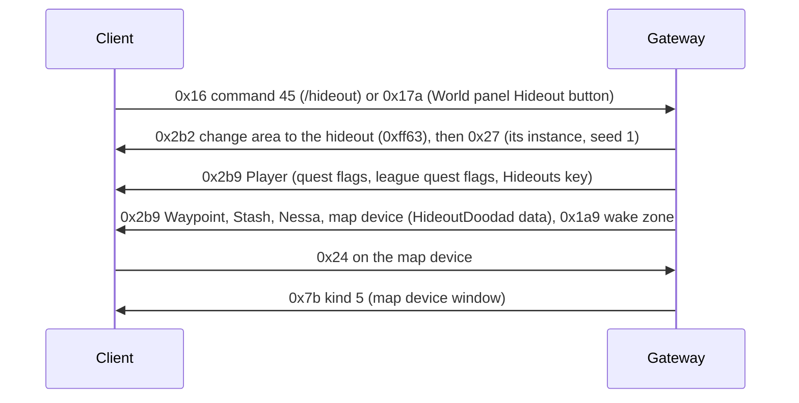

# 21. Hideouts

State of 2026-10-20: every character has its hideout unlocked and owns the Lush Hideout. `/hideout` or the World
panel's Hideout button takes the player there, next to its waypoint. The hideout has its Waypoint (travel back), its
Stash, Nessa and a map device that opens the map device window. The HUD shows the hideout Edit button. Verified live
(2026-10-20): travel, arrival, the stash, Nessa, the Edit button showing, the map device hovered, clicked and its window
opened. Not done yet: the decorations, editing, the map device's slots and activation, logging in to the hideout.



## 1. Unlocking: flags and keys

| What | Where | Value |
|---|---|---|
| quest flag `HideoutUnlocked` | QuestFlags row 2030, Player +0x1b8 | every character (`Quests.EveryCharacter`, added on login, not saved) |
| quest flag HASH32 `0x2f1b9c25` | QuestFlags row 718 (the schema names it `HideoutJukeboxEnabled`) | the HUD's hideout panel checks it (`0x14216c840` → `0x1401ff190`) |
| quest flag `CanEditHideout` | row 2593 | tested before the Edit button shows (live flag trace); with it the button shows |
| quest flag `MapDeviceActive` | row 2582 | the map device's per-player "active" state (its `.ot`: `per_player_quest_flag_state_active_1`) |
| league quest flags `UnlockedHideouts` 3, `HaveHideout` 200, `UnlockedMapDevice` 350 | Player +0x1d0 | every character (`Quests.League`); the map device's Targetable needs `UnlockedMapDevice` |
| Hideouts keys | Player, two u16 after the 9 raw bytes (→ +0x1f8, +0x208) | the first is the Lush Hideout's Hideouts HASH16 `0xff63`; the second stays 0 |

**League quest flags** are a set of their own, not a table: the client has their names built in, sorted, with ids
(`0x142fca900`, 0x776 entries of {UTF-16 name, length, u32 id}; binary search `0x1423f1fb0`, wrapper `0x141de7f60`,
0x777 = unknown). They live in the Player component's **second flag set** (+0x1d0; same layout as the quest flags,
04 §4.6; update bit 0x08, `PlayerLeagueQuestFlagsUpdate`). **The client tests bit id − 1** (`0x14155cdf0`, and the map
device's Targetable at `0x141e65563`, which tested bit 349 for `UnlockedMapDevice` 350): `Quests.League.Bits`. Quest
flags (QuestFlags rows) are tested by row, without the shift. `/league_flag [<id> [off]]` (dev) sets them by id.

**How these were found:** a Frida hook on the flag-set test `0x14012aae0(set, bit)` logged each (caller, bit, result)
while hovering the map device and opening the HUD; the failing tests named the missing flags. The Player component
holds both sets (+0x1b8, +0x1d0); a copy of them sits in another object (+0x3c0 further on).

**The Hideouts keys** (reader `0x141e7dc10`, update bit 0x10 `0x141e7ee30`, `PlayerHideoutsUpdate`) are looked up by
HASH16 in Hideouts.dat (a failed lookup gives null). An update calls the component's vtable +0x130. Which UI reads
which key is not known; `/hideout_keys <a> <b>` (dev) sends both.

## 2. The hideout area and its decoration

Each Hideouts.dat row names its area (`HideoutArea`, a WorldAreas row with `IsHideout`) and its default decoration
(`HideoutFile`). The Lush Hideout: Hideouts row 0, WorldAreas `HideoutForest` (HASH16 `0xff63`, the same as its
Hideouts HASH16), found in The Dread Thicket. It is a fixed layout (one room, `forest_hideout.dgr` → `hideout.arm`,
21 × 21 tiles); the client generates it at seed 1 and reports a 253 × 253 walkability texture, a third of its 759 × 759
cells (Lioneye's Watch: 230 × 138 for 690 × 414).

A `.hideout` file is JSON (UTF-8 with BOM) whose `doodads` object **repeats keys**, one per placed doodad, named after it:

```json
"Waypoint": { "hash": 1224707366, "x": 218, "y": 335, "r": 16384, "fv": 5 }
```

| Field | Meaning |
|---|---|
| `hash` | MtxTypeGameSpecific HASH32; the HideoutDoodads row whose `MtxTypeGameSpecific` is that row gives the object type (`InheritsFrom`) and its models (`Variation_AOFiles`) |
| `x`, `y` | grid cells |
| `r` | rotation, 65536 = a full turn |
| `fv` | variation: index into `Variation_AOFiles` |

`dotnet run --project scripts/re/atlas -- Client/Content.ggpk hideouts` writes every hideout's decoration to
`data/hideouts.json` (game data, git-ignored; 103 hideouts, 14 150 doodads). The Gateway's `HideoutCatalog` resolves the
hashes. The Lush Hideout's: Stash (230, 364), Waypoint (218, 335, `waypointcore_forest.ao`), Crafting Bench (251, 351),
Map Device (449, 460; moved to (257, 283), the user's pick), lockers, the masters' spot (218..223, 325), and decorations.

**The HideoutDoodad component** (`0x141e1c550`) reads `u32` MtxTypeGameSpecific HASH32, `u8` variation and `u8` flag
(0 seen) **only when the object's data has +0x14e set**: never in town, always in a hideout. The Waypoint has the
component, so in a hideout it needs the 6 bytes (without them: "Buffer Underflow" on entry, live 2026-10-20).
`HideoutDoodad` record, `WaypointObject.Hideout`.

**Instances:** a private instance per character like other areas (Auth re-enters the character's live one); hideouts
always use seed 1, also with `Game_RANDOM_SEEDS=1` (`WorldAreaHideouts`).

## 3. Going there

| Message | Bytes | Meaning |
|---|---|---|
| C→S 0x16 command 45 | `0016 2D 0000` | `/hideout`: Commands.dat row 44 `WarpToHideout` + 1 (`SendsGenericCommandPacket`); the client never sends it as chat |
| C→S 0x17a | `017A 0008 446576576974636800 002F00 00` | the World panel's Hideout button: u16 n + n bytes UTF-8 character name (whose hideout), u32 BE the waypoint object the panel was opened from, u8 (0) |

Both change area to the character's hideout with the waypoint arrival (`PendingTransfer.AtWaypoint`): the player
appears next to the hideout's waypoint. The hideout's waypoint opens the World panel as any other (16-waypoints.md).

## 4. Objects in the hideout

| Object | Type | Blob |
|---|---|---|
| Waypoint | `Metadata/MiscellaneousObjects/Waypoint` | as in town (16 §2) plus HideoutDoodad after Animated |
| Stash | `Metadata/MiscellaneousObjects/Stash` | as in town (18 §1); no HideoutDoodad component |
| Nessa | `Metadata/NPC/Act1/Nessa` at (256, 351) | as in town (17); the real game has no town NPCs in hideouts |
| Map device | `Metadata/Terrain/Missions/Hideouts/Objects/StrDexIntMappingDevice` | `HideoutObject`: Positioned (stash style), Animated `00`, InteractionAction `00`, HideoutDoodad, StateMachine (opening 0, active 1), MinimapIcon `00`, tasks |

The map device's `.ot`: Targetable `is_map_device = true`, `required_league_quest_flag = "UnlockedMapDevice"`;
StateMachine `define_shared_state = "opening; active;"` with `per_player_quest_flag_state_opening_1 = "MapDeviceOpening"`
and `…_active_1 = "MapDeviceActive"`. Clicking it sends C→S 0x24; the server walks there and sends **S→C 0x7b kind 5**,
which opens the **map device window** (case 5 → listeners at instance +0x1778 → HUD `0x140dcd9a0`, the window at HUD
+0x7d8 built by `0x140c276c0`, mode 0xd). Its other modes are on +0x17f8 (`0x140dce1f0`, mode 0x5e) and +0x1878
(`0x140dce290`, mode 0x56). The window's slots are Inventories row 13 `Map1` (3 × 2), already registered on login.
The client sent C→S `0x00d8 000000` once while the window was open (not decoded).

## Open

- The decorations (trees, tents …): `Metadata/MiscellaneousObjects/HideoutDoodad` and other types, each with its own
  component list; `HideoutObject` writes the supported ones.
- Editing: the Edit button shows; moving, placing and saving doodads (the client's messages) are not served.
- The map device: putting maps in its slots, Activate, portals; C→S 0x00d8.
- Logging in to the hideout after logging out there (the real game does); Resurrect in a map → the hideout.
- Choosing another hideout (the Hideout selection window), visiting other players' hideouts (0x17a names them).
- Which UI reads the second Hideouts key.
