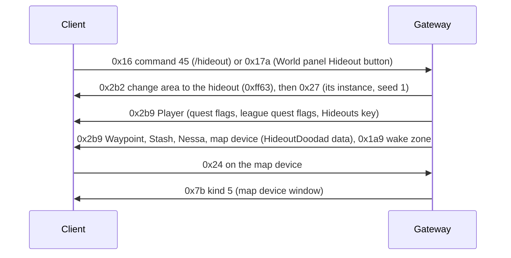
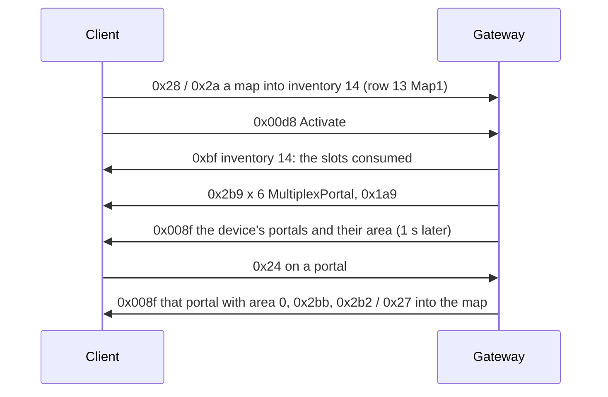

# 21. Hideouts

State of 2026-10-20: every character has its hideout unlocked and owns the Lush Hideout. `/hideout` or the World
panel's Hideout button takes the player there, next to its waypoint. The hideout has its Waypoint (travel back), its
Stash, Nessa and a map device that opens the map device window. The HUD shows the hideout Edit button. Verified live
(2026-10-20): travel, arrival, the stash, Nessa, the Edit button showing, the map device hovered, clicked and its window
opened. The map device runs maps (§5, live 2026-10-20): a map goes into its slots, Activate opens the map's area and
six portals appear around the device, each taking the player into that map once. Not done yet: the decorations,
editing, logging in to the hideout, where the player arrives in a map.



## 1. Unlocking: flags and keys

| What | Where | Value |
|---|---|---|
| quest flag `HideoutUnlocked` | QuestFlags row 2030, Player +0x1b8 | every character (`Quests.EveryCharacter`, added on login, not saved) |
| quest flag HASH32 `0x2f1b9c25` | QuestFlags row 718 (the schema names it `HideoutJukeboxEnabled`) | the HUD's hideout panel checks it (`0x14216c840` → `0x1401ff190`) |
| quest flag `CanEditHideout` | row 2593 | tested before the Edit button shows (live flag trace); with it the button shows |
| quest flag `MapDeviceActive` | row 2582 | the map device's per-player "active" state (its `.ot`: `per_player_quest_flag_state_active_1`) |
| league quest flags `UnlockedHideouts` 3, `HaveHideout` 200, `UnlockedMapDevice` 350 | Player +0x1d0 | every character (`Quests.League`); the map device's Targetable needs `UnlockedMapDevice` |
| Hideouts keys | Player, two u16 after the 9 raw bytes (→ +0x1f8, +0x208) | the first is the Lush Hideout's Hideouts HASH16 `0xff63`; the second stays 0 |

**League quest flags** are a set of their own, not a table: the client has their names built in, sorted, with ids
(`0x142fca900`, 0x776 entries of {UTF-16 name, length, u32 id}; binary search `0x1423f1fb0`, wrapper `0x141de7f60`,
0x777 = unknown). They live in the Player component's **second flag set** (+0x1d0; same layout as the quest flags,
04 §4.6; update bit 0x08, `PlayerLeagueQuestFlagsUpdate`). **The client tests bit id − 1** (`0x14155cdf0`, and the map
device's Targetable at `0x141e65563`, which tested bit 349 for `UnlockedMapDevice` 350): `Quests.League.Bits`. Quest
flags (QuestFlags rows) are tested by row, without the shift. `/league_flag [<id> [off]]` (dev) sets them by id.

**How these were found:** a Frida hook on the flag-set test `0x14012aae0(set, bit)` logged each (caller, bit, result)
while hovering the map device and opening the HUD; the failing tests named the missing flags. The Player component
holds both sets (+0x1b8, +0x1d0); a copy of them sits in another object (+0x3c0 further on).

**The Hideouts keys** (reader `0x141e7dc10`, update bit 0x10 `0x141e7ee30`, `PlayerHideoutsUpdate`) are looked up by
HASH16 in Hideouts.dat (a failed lookup gives null). An update calls the component's vtable +0x130. Which UI reads
which key is not known; `/hideout_keys <a> <b>` (dev) sends both.

## 2. The hideout area and its decoration

Each Hideouts.dat row names its area (`HideoutArea`, a WorldAreas row with `IsHideout`) and its default decoration
(`HideoutFile`). The Lush Hideout: Hideouts row 0, WorldAreas `HideoutForest` (HASH16 `0xff63`, the same as its
Hideouts HASH16), found in The Dread Thicket. It is a fixed layout (one room, `forest_hideout.dgr` → `hideout.arm`,
21 × 21 tiles); the client generates it at seed 1 and reports a 253 × 253 walkability texture, a third of its 759 × 759
cells (Lioneye's Watch: 230 × 138 for 690 × 414).

A `.hideout` file is JSON (UTF-8 with BOM) whose `doodads` object **repeats keys**, one per placed doodad, named after it:

```json
"Waypoint": { "hash": 1224707366, "x": 218, "y": 335, "r": 16384, "fv": 5 }
```

| Field | Meaning |
|---|---|
| `hash` | MtxTypeGameSpecific HASH32; the HideoutDoodads row whose `MtxTypeGameSpecific` is that row gives the object type (`InheritsFrom`) and its models (`Variation_AOFiles`) |
| `x`, `y` | grid cells |
| `r` | rotation, 65536 = a full turn |
| `fv` | variation: index into `Variation_AOFiles` |

`dotnet run --project scripts/re/atlas -- Client/Content.ggpk hideouts` writes every hideout's decoration to
`data/hideouts.json` (game data, git-ignored; 103 hideouts, 14 150 doodads). The Gateway's `HideoutCatalog` resolves the
hashes. The Lush Hideout's: Stash (230, 364), Waypoint (218, 335, `waypointcore_forest.ao`), Crafting Bench (251, 351),
Map Device (449, 460; moved to (257, 283), the user's pick), lockers, the masters' spot (218..223, 325), and decorations.

**The HideoutDoodad component** (`0x141e1c550`) reads `u32` MtxTypeGameSpecific HASH32, `u8` variation and `u8` flag
(0 seen) **only when the object's data has +0x14e set**: never in town, always in a hideout. The Waypoint has the
component, so in a hideout it needs the 6 bytes (without them: "Buffer Underflow" on entry, live 2026-10-20).
`HideoutDoodad` record, `WaypointObject.Hideout`.

**Instances:** a private instance per character like other areas (Auth re-enters the character's live one); hideouts
always use seed 1, also with `Game_RANDOM_SEEDS=1` (`WorldAreaHideouts`).

## 3. Going there

| Message | Bytes | Meaning |
|---|---|---|
| C→S 0x16 command 45 | `0016 2D 0000` | `/hideout`: Commands.dat row 44 `WarpToHideout` + 1 (`SendsGenericCommandPacket`); the client never sends it as chat |
| C→S 0x17a | `017A 0008 446576576974636800 002F00 00` | the World panel's Hideout button: u16 n + n bytes UTF-8 character name (whose hideout), u32 BE the waypoint object the panel was opened from, u8 (0) |

Both change area to the character's hideout with the waypoint arrival (`PendingTransfer.AtWaypoint`): the player
appears next to the hideout's waypoint. The hideout's waypoint opens the World panel as any other (16-waypoints.md).

## 4. Objects in the hideout

| Object | Type | Blob |
|---|---|---|
| Waypoint | `Metadata/MiscellaneousObjects/Waypoint` | as in town (16 §2) plus HideoutDoodad after Animated |
| Stash | `Metadata/MiscellaneousObjects/Stash` | as in town (18 §1); no HideoutDoodad component |
| Nessa | `Metadata/NPC/Act1/Nessa` at (256, 351) | as in town (17); the real game has no town NPCs in hideouts |
| Map device | `Metadata/Terrain/Missions/Hideouts/Objects/StrDexIntMappingDevice` | `HideoutObject`: Positioned (stash style), Animated `00`, InteractionAction `00`, HideoutDoodad, StateMachine (opening 0, active 1), MinimapIcon `00`, tasks |

The map device's `.ot`: Targetable `is_map_device = true`, `required_league_quest_flag = "UnlockedMapDevice"`;
StateMachine `define_shared_state = "opening; active;"` with `per_player_quest_flag_state_opening_1 = "MapDeviceOpening"`
and `…_active_1 = "MapDeviceActive"`. Clicking it sends C→S 0x24; the server walks there and sends **S→C 0x7b kind 5**,
which opens the **map device window** (case 5 → listeners at instance +0x1778 → HUD `0x140dcd9a0`, the window at HUD
+0x7d8 built by `0x140c276c0`, mode 0xd). Its other modes are on +0x17f8 (`0x140dce1f0`, mode 0x5e) and +0x1878
(`0x140dce290`, mode 0x56). The window's slots are Inventories row 13 `Map1` (3 × 2), already registered on login.
The client sent C→S `0x00d8 000000` once while the window was open (not decoded).

## 5. The map device: slots, Activate, portals



**Slots.** Inventories row 13 `Map1` (3 × 2, inventory id 14) is an ordinary grid: items go in and out with the usual
item messages (13-items.md). The server takes only the ItemClasses `Map` and `MapFragment` there
(`PlayerInventories.Accepts`). Maps need the item **Map** component (read `0x1423f3f10`, write `0x1423f3e60`: u8 +0x19,
u8 +0x18, u8 flag, then a u32 HASH32 when the flag is set; the server sends three zeros). `/item Beach Map` makes one
(`MapAtlasBeach`, tier 2).

**Activate** is **C→S 0x00d8** (5 bytes): u16 BE, u8. The window's button handler `0x140c2a1c0` (window mode 0xd)
calls `0x142166480`, which writes a u16 from the target its slots name (+0x7b; 0 seen with a map in the slots) and a
u8 (0 seen); the writer class is `0x1435bff20`, as C→S 0xc7. Mode 0x5e (another device) sends C→S 0x296 instead.
The server checks the slots itself (`MapDevice.Check`): only maps and map fragments, and exactly one map. Otherwise
nothing is consumed and a chat line (S→C 0x17) gives the reason. Then the slots are emptied (0xbf), the map's area
opens (Maps.dat `BaseItemTypesKey` → `Regular_WorldAreasKey`), and six portals appear on a ring of 16 cells around
the device. Fragments are consumed with the map but add nothing yet.

**Portals** are `Metadata/MiscellaneousObjects/MultiplexPortal` (`MapPortalObject`): Positioned, BaseEvents, StateMachine,
Animated, Portal, Transitionable, MinimapIcon, InteractionAction, all read except BaseEvents (Frida
`check-components.js`: 36 bytes, nothing left). StateMachine holds PortalBase.ot's shared states (standard_portal 1,
portal, map_device_index, map_device_large). The Portal component (`0x141e2cee0`) reads one u8, the multiplex portal
type (`0x141e2cf40` stores it in the "portal" state; MultiplexPortal.ot: 1 player, 2 town, 3 map device, 4 map return).

**A portal object alone is never drawn.** **S→C 0x008f** (class `0x1435dcc00`, read `0x1421a0a00`; dispatcher case
0x21 → `0x142186070`) lists the device's portals:

| Field | Meaning |
|---|---|
| u8 | flags: bit0 → +0x32, bit1 → +0x33, bit2: a u64 follows at the end |
| u8, u8 | +0x2e, +0x31 (0) |
| u32 BE | the map device object (looked up; its Functions get `on_map_portal_opened` / `on_map_portal_closed`) |
| u16 BE, u8, u8 | +0x2c, +0x2f, +0x30 (0) |
| u8 n, n × entry | `0x1421b9af0`: u32 BE portal object, u16 BE area HASH16; when the area is not 0: u16 BE portal variation (MicrotransactionPortalVariations; 0 the default), u8, u8, u8 model (`0x141e2d240`: 0, 1, 2 pick three built-in models), wstr (the owner's name) |

For each listed portal object the client already has, PortalClient vtable +0xb8 (`0x14161a020`) gives it its area, its
model and rendering, and the device runs `on_map_portal_opened` (index, object). A portal that was listed before and
is now missing or has area 0 closes (+0xc0) and runs `on_map_portal_closed`. Seen live:
- 0x008f in the same burst as the portals' 0x2b9 reaches none of them (they are not created yet); on entering an area
  the objects also wait for the world to activate. The Gateway sends it 1 s after creating them (2 s on entry).
- Type 3 (map device) gets its nametag but no model: MultiplexPortal.ot enables its rendering only `on_transition`.
  Created untransitioned and opened with S→C 0x2ba to Transitionable (component 5, u8 1), the client hung, or
  crashed with the update 2 s later; that was before 0x008f had given the portal its area. **Type 1 (player) renders**,
  so the Gateway uses it (`Game_MAP_PORTAL_TYPE` overrides).

**Taking a portal** (C→S 0x24): the player walks there, the portal is sent with area 0 in 0x008f and removed (0x2bb),
and the player changes area into the map: the first portal makes a new instance (Auth "transfer" New), the others enter
that one (`MapDevice.Entered`). The open map is kept per character in the Gateway (`MapDevice.OpenOf`; lost on a Gateway
restart), so the portals left stand at the device again when the player comes back. A new Activate replaces them.
`/map_portal [type] [created] [open ms] [model]` (dev) places one test portal.

**Timing and order.** The portals left come up one after another, `Game_MAP_PORTAL_GAP_MS` (150) apart; each is listed
in 0x008f `Game_MAP_PORTAL_LIST_MS` (100) after its create; on entering the hideout the first waits
`Game_MAP_PORTAL_ENTRY_MS` (1500). With a list delay of 0 each portal is drawn only by the next one's list, so the last
never is (live). The open map keeps the places left (0–5 on the ring), so the portal taken is the one missing later.

**In the map.** Every area a map opens (`MapDevice.IsMapArea`) gets a portal back next to the arrival point, listed in
0x008f with device 0 (the handler then skips the device's events but still sets the portal's area): it leads to the
hideout and is not used up. The map's monster packs are its Maps.dat `MonsterPacksKeys` (Beach: `atlas-crab1`, level
69), which no MonsterPacks row lists by area (14-monster-packs.md). Beach's boss room (`MapBeach2/Rooms/boss_1.arm`,
points `teleport1-%areaname%`, `telepad1`, `teleport2-Arena`, `telepad2`) has two `grovewall_entrance` gates that no
topology transition names: two such captured gates are paired, each teleporting the player (0x1b7) next to the other
(`AreaTransitionObject.TeleportTo`); the telepads' own cells are not in `data/room-points.json`. Nessa sells 10 Beach
Maps. Beach's walk map is a `-Walkmaps` capture (2484 × 1656; spawn the deepest cell, (459, 884)).

**Portal Scroll** (C→S 0x58, `UsePortalScroll`). Outside towns and hideouts one scroll is spent and the same portal object
opens 3 cells beside the player, listed in 0x8f with device 0. There is one per player: a new scroll closes the old portal
(0x8f with area 0, then 0x2bb) and moves it, the map's own portal back included. From a map area it leads to the hideout,
anywhere else to the character's last town (`ClientState.ReturnPortalTo`), at its spawn. In a town or a hideout
nothing happens and nothing is spent. Live 2026-10-21: in a map and in the acts. Not yet: the portal's other end in the
town (the way back), and the portal staying after the player leaves the area.

## Open

- The decorations (trees, tents …): `Metadata/MiscellaneousObjects/HideoutDoodad` and other types, each with its own
  component list; `HideoutObject` writes the supported ones.
- Editing: the Edit button shows; moving, placing and saving doodads (the client's messages) are not served.
- The map device: the arrival in a map without a walk map (the player can stand in the sea; `live.ps1 -Walkmaps` per
  map), the telepads' exact cells, fragments and device recipes (MapDeviceRecipes), the map's mods and area level, the map
  device type (3) portal's own model and "Map Portal" text (needs its open transition, which crashed), the window's
  u16 target and the 0x008f fields left at 0.
- Logging in to the hideout after logging out there (the real game does); Resurrect in a map → the hideout.
- Choosing another hideout (the Hideout selection window), visiting other players' hideouts (0x17a names them).
- Which UI reads the second Hideouts key.
