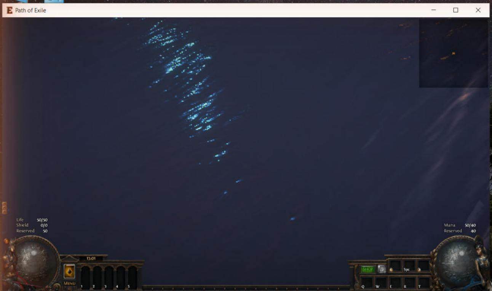

# 010 — Live login → character select → instance connect (2026-10-16)

> Working notes. Consolidated and corrected in [Agents/docs/protocol/](../protocol/00-overview.md). In particular the
> statically guessed component order below was wrong; [04-player-entity.md](../protocol/04-player-entity.md) has the
> traced one.

First end-to-end run of the patched 3.29.3b client (`scripts/dev/live.ps1`) against `GameServer.Auth serve`,
`GameServer.Patch` and the `GameServer.Gateway` capture stub. Logs: `Tools/re/out/live-*.log`.
Covered by `LoginServerSessionTests.Live_verified_flow_lists_characters_and_assigns_an_instance`.

## Login connection (Salsa20 after the doc 008 handshake)
| Step | Client → server | Server → client | Client behaviour |
|---|---|---|---|
| 1 | 0x03 account login (SHA-256 of UTF-16LE password) | 0x04 result 0, Flags0 = 0x20 (verified) | logged-in state 3. A non-empty name in 0x04 pops up a message box. |
| 2 | — | 0x1b (empty char list, server time) | moves on to the character screen |
| 3 | 0x18 | 0x15 list (+0x48 level, +0x4a class, league text "Standard") | character screen shows the characters |
| 4 | 0x0e (u8 0, u32 0) on Play | 0x14 instance info | "Contacting Server..." until 0x14 arrives |
| — | 0x01 (empty) repeatedly | — | keepalive while the login socket stays open |

0x14 as sent: host `"127.0.0.1"`, u16 port 6112 (the +0x30 field is the port: confirmed, the client dialled it),
u32 0x7F000001, u16 area hash 0x235c (`WorldAreas.HASH16` of `1_1_town`, Lioneye's Watch), u32 0, 64 + 8 zero key bytes,
u8 0. The client accepted the area hash and started loading Lioneye's Watch. (Since then, the u32 at +0x38 is a random
ticket and the 64 key bytes are `InstanceKeyring.Key(ticket)`.)

## Instance connection (:6112), static analysis (Ghidra, 2026-10-16)
Implemented in `src/GameServer.Core/Protocol/Instance/InstanceProtocol.cs` and served by `GameServer.Gateway`. Tests:
`InstanceProtocolTests`. Helpers added: `scripts/re/ghidra/Callers.java` (who references a symbol or address) and
`FindHtons.java`.

### Connect path
- Instance client object (`this`): ctor `0x142144b50`, vtables `0x14345e810` (slot 0 = tick `0x142148880`) and
  `0x14345e8b8` at `this+8` (slot 0 = S→C dispatcher `0x14214a190`).
- Tick `0x142148880` starts the connect job `0x142506420` → thread `0x1425064d0` → `0x1425066e0`. That is a
  happy-eyeballs connect: getaddrinfo, non-blocking connect to every address, select, keep the first that succeeds. The
  socket is wrapped by `0x140dfaf70` in the same 0x2b8-byte stream class as login. It logs "Connect time to instance
  server was …", stores the stream at `this+0xc288` and calls `0x142148500`.
- State `this+0xc3a0`: 1 = idle or disconnected, 2 = hello sent (`0x142148500`), 3 = in area (`0x142156d80`).
- Sending: `0x14216e940(this, &msg)` calls the message's write slot (vtable slot 1), then `0x140dfb8c0` flushes.
  The message objects carry `u16 id` at +8, which is why `htons(0x0f)` never shows up as an immediate.

### Client opening (plaintext, `0x142148500`)
| Id | Class | Fields | Source |
|---|---|---|---|
| 0x0F | `0x14316c420` (login's u32 class) | u32 ticket | 0x14 u32 at +0x38 |
| 0x0E | `0x1435bf9e8` | bytes[12] digest, u32, u32 0, u8 realm 0x40, u8 flag | digest over the constant `0x142fbfbf8` (8 B), 0x14 Data8 and the u32 `_time64` (hash family `0x141fe1570`, algorithm not identified); the first u32 is 0x14's u32 at +0x34 |

The capture decodes completely: `000F 00000000` + `000E 76240850BFE2B4956AD1D6B0 7F000001 00000000 40 01`.

### Server side
- Read loop: pump `0x14299e440` reads a u16 BE id and offers it to the registered handler groups
  (`0x14299e3b0` registers). If none accepts: "Unable to deserialise packet with pid". The instance pump at
  `this+0xc2b0` has two groups: the instance client's own (`this+0xc2a0`, vtable `0x1435d9d98`, factory
  `0x1421b5c40`, about 300 ids) and the world's (`world+0x1c8`, via `0x142188cc0`).
- The dispatcher `0x14214a190` jumps through a byte table at `0x142154e14`, indexed by `id − 0x0d`. Early cases:
  0x0d → 0, **0x11 → 1**, 0x17 → 2, 0x18 → 3, 0x19 → 4, 0x1c → 5, 0x1d → 6, 0x1e → 7, 0x1f → 8, 0x20 → 9,
  **0x21 → 10**, 0x22 → 11.
- **0x11** (no fields, class `0x14316c930`): builds `0x140e03a30(key64, isClient=1)`, the same Salsa20 pair as login,
  with km = the 64 key bytes from 0x14. It installs the pair on the stream (`0x140dfbe30`, which also decrypts bytes
  already buffered after 0x11). A second pair goes on a side channel at `stream+0xd0`
  (`0x14299db60`: key XOR the 64 bytes at `0x142fe0da0`, then swaps bytes 0↔0x15, 4↔2, 0xd↔0x2a, 0x30↔1, 0x1d↔0x1e and
  0x32↔0x13). So the server sends `00 11` in plaintext, and every byte after it in both directions is Salsa20.
- **0x21** (class `0x1435dcb80`, 0x80 bytes, write `0x1421a2da0`, read `0x1421a2fe0`): enter area. Its handler calls
  `0x142156d80`, which binds the local player and area and sets state 3. Wire layout: vec16 of 0x68-byte records
  (`0x141d4d020`), a second vec16 of the same, vec16 of (u32, u32), wstr, 3 raw bytes (24 flag bits, `+0x78`), u8
  (`+0x7e`, passed to world vtable +0x150), u8 bits (0 = `+0x7b`, 1 = `+0x7c`, 2 = `+0x7d`). The world object
  presumably has to finish loading the area first, so the server probably sends other messages before 0x21.

## Live run 2 (2026-10-16 11:30): 0x11 + 0x1d accepted, area generated
- Only 0x11: the client accepted it, kept the connection open and sent nothing for 45 s. It waits for the server.
- **0x1d** (case 6; class `0x1435da180`, write `0x1421415c0`). Wire order with every optional part off:
  u32 instance id (+0x10), u16 area hash (+0x14), wstr (+0x30), u32 seed (+0x18), u8 +0x1e, u8 +0x20, u8 +0x1f,
  u8 +0x24, 3 flag bytes (+0x21..+0x23), u8 level (+0x1c, 0 = the area's own level), u8 +0x1d, u8 +0x28,
  vec16⟨u32⟩ (+0x68), vec16⟨u8⟩ (+0x80), vec8⟨u8⟩ (+0x50), vec16⟨u16⟩ (+0xe0). Optional parts: +0x21 bit3 → u16
  second area hash (+0x16) after +0x28; bit7 → vec8⟨u8⟩ +0x98; +0x22 bit0 → vec8⟨u8⟩ +0xb0; bit1 → `0x1421732e0`
  (+0xc8); +0x21 bit6 → varint pair lists; +0x22 bit2 → vec16⟨u8⟩ +0x150. `AreaInstance` encodes the minimal form with
  the constructor's defaults (3, 0, 2, 0x23, …, 0x3c).
- Sending `00 11` and then `AreaInstance(1, 0x235c, seed 1, level 0)` (encrypted) produced in the client log:
  "Client-Safe Instance ID = 1", "Generating level 13 area "1_1_town" with seed 1", Tile hash 1139181677,
  Doodad hash 2393431363, "[SCENE] Set Source [Lioneye's Watch]". The client then sent its first encrypted message:
  `007D 43E6886D 8EA8DD43` = **C→S 0x7d (u32 tile hash, u32 doodad hash)**, the "area generated" report from the tick
  (`0x142148880`, sent when `+0xe1f9` is set; class `0x1435bf8a8`). The decrypted id proves the Salsa20 keying.
- Seen in an old real-server session in `Client/logs/Client.txt` (2026-02-13): "Got Instance Details" → "Connecting to
  instance server" → "Client-Safe Instance ID" → "Generating level … with seed …" → Tile/Doodad hash → "[SCENE] Set
  Source" → "Joined guild" → "You have entered Highgate.", which is the order to aim for.

## Entering the area: what 0x21 needs (static, 2026-10-16)
- **0x21 records** (0x68 bytes, write `0x141d4d020`): u32 +0x28, u32 +0x2c, wstr +0x08, blob16 +0x48, u16 +0x38,
  2 raw bytes +0x3d/+0x3e (flags), u16 +0x3a, u8 +0x30, u8 +0x31, u8 +0x32, u8 +0x34; then if flags(+0x3d) & 0x20 →
  raw u64 +0x00; & 0x10 → u8 +0x3c; & 0x40 → 4 raw bytes +0x3f. Probably player/party entries. Both lists can be empty.
- **Blocker:** 0x21 → `0x142156d80` takes the world's first local entity (`world vtable+0x138`) and its "Player"
  component (`0x14013f1e0`) **without a null check**. Sending 0x21 before a player entity exists would crash the
  client, so it has not been tried live.
- **S→C 0x22** (dispatcher case 0xb, class `0x14316c420`, u32): sets `world+0x980` (local player entity id, setter
  `0x142186fa0`) and `instance+0xc7fc`.
- **World handler group**: vtable `0x1435da300`, factory `0x1421c6150`, handler `0x142187480` (ids 0x51, 0x84, 0x161,
  0x1a8–0x1d3, 0x1f0/1, 0x22f/230, 0x261/262, 0x26f–271, 0x285, 0x2b5–0x2c6). The four handler groups share the
  generic handle slot `0x14299e300`: login `0x1435d8b50`, instance `0x1435d9d98`, world `0x1435da300` and
  NetworkFile `0x14363eb88`.
- **S→C 0x2b9 create object** (class `0x1435dd8f8`, write `0x141fe04d0`): u16 id, entity header (u32 entity id +0x10,
  u32 +0x14, u16 +0x18; `0x141f91f60`), u32 object type +0x20, blob16 component data +0x28. The type is looked up in a
  runtime-filled sorted map at `world+0x8d8` (`0x1416719b0`; a missing type → no object), so some message must register
  types first (not found yet). The blob is parsed by `0x141ebe190`: u8 flags (bit0 → +0x8c|0x80, bit1 → +0x8d|2), then
  `0x141dea920`, then each component's vtable+0x88 deserializer in .ot order, then `0x141ee00f0`. If the entity id
  equals `world+0x980`, the object becomes the local player (`world+0x970`).
- So the target order is: 0x11 → 0x1d → (C→S 0x7d) → 0x22 player id → [type registration] → 0x2b9 player object →
  0x21 enter area. The real-server log shows "Joined guild …" and "You have entered Highgate." after "Set Source".

## Player entity (static + live, 2026-10-16)
Implemented in `src/GameServer.Core/Protocol/Instance/InstanceEntities.cs` (`ObjectTypeHash`, `SetLocalPlayer`,
`CreateObject`, `PlayerObject.Blob()`), tests `InstanceEntitiesTests`. The Gateway answers C→S 0x7d with 0x22 + 0x2b9,
and also 0x21 when `Game_GATEWAY_ENTER=1`.

### Object types need no registration message
- `world+0x8d8` is `Game::GameObjectTypeRegister` (resource "Metadata/GameObjectRegister", `0x141ee54b0`). It is
  **built locally from dat tables** (`0x141ec18c0`: rows of tables with row sizes 0x141, 0xac, 0xea, 0x264
  (Characters.dat, base "Metadata/Characters/Character"), 0x31a, 0x8a, 0x2c, 0x9c).
- Key = **MurmurHash2, seed 0, over the path with each UTF-16 unit narrowed to a byte** (`0x1424748a0` →
  `0x140df8570`). Witch `Metadata/Characters/Int/Int` = `0x9c41993e`. A missing key logs "Unknown object type
  serialized by server".

### World messages are queued until 0x21
- The world handler `0x142187480` drops nothing: while `world+0xb7a` is 0, messages are queued (`world+0x9e0` list).
  `0x142183670` (world vtable +0x1c8, called from the 0x21 handler `0x142156d80`) sets `+0xb7a`, **replays the
  queue** (so 0x2b9 is only parsed when 0x21 arrives), then reads the local player's Player component without a check.
- So 0x22 + 0x2b9 without 0x21 is harmless (verified live: no reaction). 0x21 triggers everything.

### 0x2b9 component blob (little-endian; reader `0x141ebe190`)
u8 object flags · base data (`0x141dea920`: u8 n, n × (raw u32, u8, sub-data)) · for each of the type's components
its vtable+0x88 deserializer · tasks (`0x141ee00f0`: u8 n, n × (u16 task id, …)).
Component classes have no RTTI. Each has a static descriptor/pool, registered by name in an initializer
(`0x14006xxxx`: `lea rdx,"Name"; lea rcx,pool`). The factory (the only other user of the pool) builds the component and
sets its vtable:

| Component | factory | vtable | +0x88 deserializer | minimal bytes |
|---|---|---|---|---|
| Stats | `0x141e40a20` | `0x1435a0af8` | none (`0x1400f0f00` ret) | — |
| Positioned | `0x141e2e790` | `0x1435a0f18` | `0x141e2f0b0` | i32 x, i32 y (grid), u32 +0x29c, u16 +0x1e0, 2 flag bytes |
| Pathfinding | `0x141e7ac50` | `0x1435a6ba0` | none | — |
| Life | `0x141e67110` | `0x1435a7340` | `0x141e6c2f0` | 3 pools (life, mana, ES) × [u32 +0x30, u32 +0x10, i16 +0x14, u32 +0x28, u32 +0x40], u8 flags |
| Animated | `0x141e54b20` | `0x1435a5030` | `0x141e56a80` | u8 flags |
| Player | `0x141e7d4c0` | `0x1435a64e8` | `0x141e7dc10` | u32 len + UTF-16 name, u8 class (Characters.dat row; bit5, bits6-7 ascendancy), u32 xp (`0x141e7f6b0`, level derived), u32, u16, u16, 2 × vec16⟨u8 + 8 B⟩, 9 raw B, 2 × u16 Hideouts.dat key, u8 (+0x1b1 "WashedUp"), 5 × u8, u32 n + n × u32, u8 n MTX counters (+ u32 each) |
| Inventories | `0x141e1ec10` | `0x14359e078` | slot 20 `0x141e1ee30` | u8 n inventories (u8 + `0x1424f44e0` each), u8 n2 |
| Actor | `0x141e87ec0` | `0x1435aa5d0` | none | — |

Optional parts of Positioned/Animated (flag bits) are listed in the decompiles `Tools/re/out/deser*.c`.
Spatial index: Positioned objects go into buckets of 23×23 grid units, index (y/23)·width + x/23, **no bounds check**
(`0x141d83fb0` → `0x141d7c4c0`).

### Live results
1. Order "parent components first" (Animated before Positioned) + 0x21: client crashed (AV at `0x141d7c5f0`, in the bucket
   insert `0x141d7c4c0`). That fits Positioned reading x one byte early (0x7300 → tile 1280).
2. Order as listed in Int.ot (Positioned, Life, Animated, Player, Inventories) + 0x21: got past the bucket insert. The
   client then crashed calling a **null function pointer** (fault offset 0). No dump was kept and there is no
   debugger on the machine, so where is unknown. The likely cause is data the activation path or 0x21 expects
   (Actor/skills, Stats, inventories, the 0x21 records, a Hideouts lookup that returned null).

## In game (Frida-traced, 2026-10-16 13:01)

The patched client reached the in-game state (HUD, life/mana orbs, flask and skill bars, minimap). After entering
it sends C→S **0x1b** (u8 + 4 bytes) every 100–500 ms, the state-3 tick branch of `0x142148880`. The Gateway's full
sequence after the client's 0x7d:

| # | S→C | What it does |
|---|---|---|
| 1 | 0x22 u32 0x1000 | local player id |
| 2 | 0x2b9 create object | the Witch, blob in the traced component order (167 bytes, consumed exactly) |
| 3 | 117 × 0xc0 | an empty inventory per Inventories.dat row (UI looks inventories up by row from 409 call sites) |
| 4 | 0x3d flags 0x1c | creates the 3 per-character slots at instance+0xc2f8 (probably passive trees), read by UI `0x140785160` |
| 5 | 0x21 | enter area → world activation (replays 0x2b9) → `0x142156d80` → state 3 |

How it was found: REA's Frida session (`start_frida_session` attach + `load_frida_script`) with an exception handler
(`Process.setExceptionHandler`, image-relative backtrace) and `Interceptor` hooks on each component deserializer
logging the blob reader position (reader = {data, size, pos}; pos at +0x10, size at +0x8). Each round: kill the
client, `scripts/dev/live.ps1` with `Game_GATEWAY_ENTER=1`, attach before Play.

**Traced component list of `Metadata/Characters/Int/Int`** (12; the static guesses above were wrong):

| # | vtable | +0x88 | bytes (minimal) |
|---|---|---|---|
| 0 | Positioned `0x1435a0f18` | `0x141e2f0b0` | 16 |
| 1 | `0x1435dd4e8` (stats-like) | `0x1421c2f40` | compact-int n pairs, u32, u32, u8 → 10 |
| 2 | Pathfinding | none | 0 |
| 3 | `0x14359f5f8` | `0x141e114d0` | u16 n entries → 2 |
| 4 | Life | `0x141e6c2f0` | 55 |
| 5 | Animated | `0x141e56a80` | 1 |
| 6 | Player `0x143466450` | `0x141e7dc10` | 61 for "DevWitch" |
| 7 | `0x1435a0078` | none | 0 |
| 8 | Inventories | `0x1415d8cb0` → slot 20 | 2 |
| 9 | `0x14346e558` | `0x142192a80` | u32 0 (wstr), u16, u8, [2 × u8 if a runtime value < 1: not for us], u32 +0x26c, u32 +0x274, slot 20 `0x1421932b0` (2 flag bytes) → 17 |
| 10, 11 | `0x143468920`, `0x14346c238` | not reached by the deserialize loop | 0 |

Crashes fixed on the way, in order: blob order (bucket insert AV `0x141d7c5f0`); "Buffer Underflow" (comps 1/3/9);
flask UI null inventory (row 11, `0x1402d0500`); expanded inventory row 0x54; null passive slot (`0x140785acf`).

Known wrong or open: the spawn point (115, 69) is in the sea; the HUD shows "Life 50/50 Reserved 50, Mana 50/40
Reserved 40", so the Life pool field meanings are off; nothing answers C→S 0x1b or any in-game action yet; chat
channels time out.

## Open questions / next steps
1. Spawn position: read the town's player start from the area data (or a real capture), and fix the Life pool field
   meanings (life +0x30/+0x10/+0x28 …).
2. Answer the in-game loop: C→S 0x1b tick and movement/skill messages; work out what the client expects back.
3. Make the defaults real: inventories with items, the passive slots' node lists, stats (comp1 pairs).
4. What the `stream+0xd0` side channel carries (`0x14299dd80(…, 0xdd, …)` in the tick).
