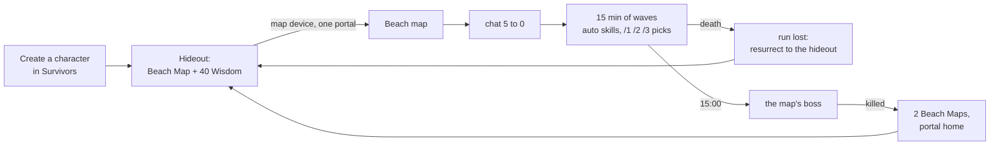

# Survivors (game mode)

State of 2026-10-21: built, unit-tested and played once live (see Open for what is not yet). Survivors is a game mode in
the spirit of the "survivors" genre: the character only moves, its skills fire on their own, and monsters come in
endless waves. It is the server's own league, not a GGG league.

Code: `src/GameServer.Gateway/Survivors.cs` (rules), `RunSurvivors` and the `Survivors*` functions in the Gateway's
`Program.cs` (the run), `LeagueCatalog.Survivors` (the league), `InstanceDirectory.AssignStart` (the hideout start).
Tests: `tests/GameServer.Gateway.Tests/SurvivorsTests.cs`.

## 1. The league

`LeagueCatalog.Default` is Standard, Allflame and **Survivors**, each with its seven Hardcore / SSF / Ruthless forms.
The create screen shows Survivors as a main league with its own card text. `Game_LEAGUES` still replaces the list.
The Gateway counts every form of the league (`Survivors.IsLeague`: the name contains "Survivors").

## 2. Start and the hideout

- **Login:** Auth starts a Survivors character in its hideout (`HideoutForest`, the Gateway's
  `HideoutCatalog.DefaultArea`) instead of its last town or The Twilight Strand. The Gateway puts it next to the
  hideout's waypoint (any login into a hideout does).
- **Start kit:** the class kit **without its skill and support gems** (the run's skills are its own), plus a **Beach
  Map** (`Metadata/Items/Maps/MapAtlasBeach`, tier 2, opens `MapAtlasBeach`, whose walk map is captured) and **40
  Scrolls of Wisdom**.
- **Skill bar:** a new bar gets **Move** on the left mouse button and the default attack after the gem skills
  (`SkillBarLayout.Fill` with `moveOnLeft`); in other leagues the left mouse button gets the default attack.
- **Never stuck:** entering the hideout without a map in the main inventory or the map device, and with no map open,
  gives a Beach Map (the stash is not checked).
- Maps carry no level requirement any more, in any league (as in the game): their drop level is not a requirement.

## 3. One life per map

- The map device opens **one portal** for a Survivors character (`MapDevice.Activate(..., portals: 1)`). Taking it
  closes the map, so the map's instance cannot be entered again.
- In the run there is **no portal back** and a Portal Scroll does nothing; it is not spent.
- **Death ends the run.** Either death screen button takes the player to the hideout.
- Leaving any other way (logging out, a crash) also ends it: the map is spent.

## 4. The run

On entering the map (0x7d) the Gateway starts `RunSurvivors` instead of the area's packs (`PopulateArea`):

1. The chat explains the rules and counts down `5` … `0 - survive!` (one line a second, holding while paused).
2. Every 200 ms (`Survivors.StepMs`) while the area runs, the survival time (`Run.Elapsed`) moves on. It stands still
   while the area is paused (the Escape menu, an open pick), so does everything timed by it: the waves' growth and
   level, the minute rares, the boss at 15:00 and the skills' cooldowns.
   - **Waves:** monsters from the map's own packs (`PackCatalog.For(area).Scattered`, Emerge monsters left out) come
     on a ring 32–46 cells around the player until `Crowd(t)` live, 2 per step: 8 at the start, +6 per minute, at
     most 70. They hunt the player and never give up (`SpawnedMonster.Hunts`); one left more than 110 cells behind is
     removed and comes back near the player.
   - **Monster level:** the character's level, +1 every 90 s (at most 84). Rarity: magic from 5% up to 20%, rare from
     0 up to 5% over the 15 minutes. Every minute the chat tells the time and a rare joins the hunt.
   - **Skills** fire when ready (§5), and Regeneration heals.
3. At **15:00** the map's unique boss comes (`AreaPacks.Bosses`; a rare of the pool when there is none), 2 levels
   above the waves, which go on at half strength. Killing it **wins**: the remaining waves go, **2 Beach Maps** drop
   where it fell, and a portal back to the hideout opens next to the player.
4. A death **loses**: the chat sums the run up and Resurrect goes home.

`/run` shows the phase, time, kills, the kills the next pick needs and the upgrades.

## 5. Skills and picks

A run starts with **Fireball 1**. Picks add or raise upgrades for this run only. Levels, passives and loot stay.

| Upgrade | Max | What it does |
|---|---|---|
| Fireball | 6 | the Fireball projectile (`FlyProjectile`, as the gem's) at the nearest enemies within 70 cells every 1.3 s; 1 + level/2 projectiles |
| Flame Ring | 5 | Righteous Fire's ring (`rifire.ao`, follows the player) burns enemies within 12 + 3 × level cells |
| Fire Burst | 5 | every 3.2 s (−0.3 s a level) the Fireball impact (`explode_new2.ao` as an effect object) on a random enemy within 55 cells hits all in 9 + level cells |
| Might | 5 | 20% more skill damage a level |
| Haste | 5 | 8% faster skills a level |
| Regeneration | 5 | 1% of maximum life a second a level |
| Reach | 3 | 15% more area and range a level |
| Vampirism | 3 | 1% of maximum life per kill a level |
| Fire Nova | 5 | every 4.5 s (−0.4 s a level) 6 + 2 × level Fireballs fly out evenly on every side |
| Meteor | 5 | every 5 s (−0.5 s a level) the enemy with the most life within 60 cells, and those within 6 cells of it, take 4× (+35% a level) |
| Swiftness | 4 | 8% more movement speed a level (a pool stat for the run: `PoolsFor`, sent at once) |
| Toughness | 5 | 8% less damage taken from monster hits a level |
| Wisdom | 5 | 15% more experience a level |
| Precision | 5 | 8% chance a level for a skill hit to deal double damage |
| Multishot | 2 | +1 Fireball target and +2 Fire Nova fireballs a level |
| Mending | — | offered only when everything is maxed: recover 30% of life |

**Damage** is a share of a normal monster's life at the *character's* level (`SurvivorsDamage`: the pool's first
monster, its life multiplier taken out), times Might, ±10%. Fireball 1 hits for 55% of such a life. The waves'
level climbs past the character's, so a run needs its upgrades. The character's gear and passives do not change the
run's skills yet. A Survivors character has no gems to start with; the default attack still works.

**Picks:** only from character levels, one per level gained in the run (no free picks, none from kills). An open pick
shows three different upgrades in chat and **pauses the area** (S→C 0x1d3, as the Escape menu does;
`Game_SURVIVORS_PAUSE=0` keeps it running). `/1`, `/2`, `/3` (or `/pick n`) take one; the next waiting pick opens or
the area resumes. Closing the Escape menu while a pick is open keeps the area paused (the Gateway answers the resume
with 0x1d3 paused).

**Experience:** in a run the game's curve is brought down to `KillsPerLevel` = 2 + level same-level normal kills a
level (3 at level 1, 4 at 2, 12 at 10, 52 at 50; the game's own: 26, 62, 140, 1 070, and 11 800 at 90):
`Survivors.ExperienceMultiplier` is the game's kills per level over that, never below 1. A rare gives 10 times a
normal monster's experience (the game's rarity multiplier is 5); magic and unique keep theirs. Wisdom adds its share.
The waves climb past the character's level, so the real pace is faster still: a run from level 1 should pass level 40.

**Loot:** monsters drop their usual items (`DropLoot`), but a normal monster only 1 time in 4 in a run (a run kills
hundreds), and gold as anywhere (`ItemDrops.Gold`, into the Survivors stash's gold, picked up by itself within 15 cells). Any monster drops a Beach Map 1 time in 400 (rares and uniques 1 in 40).

## Open

- The NPC dialogue window can only show the client's own NPCTalk rows, and the free-text dialogue (S→C 0x8c) crashed
  the client ([17](protocol/17-npcs.md)), so picks are chat lines and commands for now.
- Live 2026-10-21 a server-sent pause (0x1d3 without the Escape menu) paused the world and the chat still took `/1`.
  The rules of the second round (no starter gems, picks from levels only, the league's experience, the new upgrades,
  the pause-proof survival time) are not yet played.
- Whether `explode_new2.ao` plays as a standalone effect object (Fire Burst) is not verified; the damage is applied
  either way.
- The monsters' rarity changes no life or damage yet (monster mods are not sent), so rares and the boss are only
  tougher by their variety's life multiplier.
- No best-time scoreboard yet.
